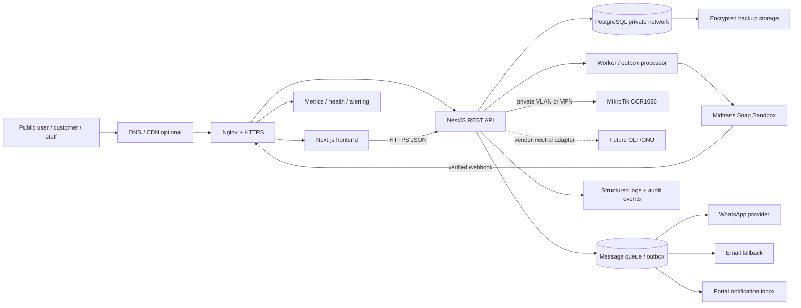

# Rancangan Arsitektur Sistem ISP FTTH

## 1. Ringkasan keputusan

Sistem menggunakan tiga proyek terpisah dengan nama produk **Instalink**:

- **Frontend**: Next.js App Router, React, TypeScript, Tailwind CSS, dan
  shadcn/ui untuk website publik, portal pelanggan, dan dashboard staf.
- **Backend**: NestJS modular monolith, TypeScript, REST JSON, Swagger/OpenAPI,
  Prisma ORM, dan PostgreSQL. Modular monolith dipilih agar operasional awal
  sederhana namun batas domain tetap jelas.
- **Infrastruktur**: Docker Compose, Nginx sebagai reverse proxy/TLS
  termination, Ubuntu Server LTS, PostgreSQL pada jaringan privat, backup
  terenkripsi, dan observability dasar.

Frontend dan backend tidak saling mengakses database. Semua aturan bisnis
berjalan di backend. Integrasi eksternal menggunakan adapter dan queue/outbox
agar kegagalan jaringan tidak merusak transaksi inti.

## 1.1 Keputusan, asumsi, dan pending

**Ditetapkan:** Indonesia, IDR, Asia/Jakarta, target 500-2.000 pelanggan,
PPPoE langsung pada MikroTik CCR1036 tanpa RADIUS tahap awal, Midtrans Snap
Sandbox sebagai opsi pembayaran awal, Ubuntu Server LTS/Docker Compose/Nginx/
PostgreSQL, RPO 24 jam, RTO 8 jam, backup harian, restore test minimal setiap
3 bulan, maintenance window Minggu 01.00-04.00 WIB, dan retensi audit awal 12
bulan. Invoice internal memakai `INV-YYYYMM-XXXXXX`, tetapi bukan faktur pajak.

**Asumsi sementara:** satu deployment modular monolith dengan worker/outbox,
WhatsApp sebagai channel utama dan email sebagai fallback, notifikasi portal,
serta suspensi/reconnect belum otomatis.

**TBD:** provider WhatsApp/email, rekening settlement dan metode Midtrans final,
detail faktur pajak/e-invoice serta status pajak perusahaan, hardware server dan
lokasi backup, detail RouterOS/topology/VPN, vendor OLT/ONU, dan matriks
approval nominal/separation of duties.

### Versi dan kebijakan kompatibilitas

Versi final dipin saat implementasi setelah verifikasi release support:

- Node.js **20 LTS atau LTS yang lebih baru dan kompatibel**, dengan minimum
  mengikuti Next.js yang dipilih (dokumentasi Next.js saat pemeriksaan:
  Node.js 20.9).
- Next.js versi stable terbaru yang kompatibel dengan React stable dan
  TypeScript.
- NestJS stable terbaru yang kompatibel dengan Node LTS.
- Prisma ORM v6 dan PostgreSQL stable yang masih mendapat dukungan.
- Docker Engine dan Compose plugin stable dari repository resmi Ubuntu/Docker.

Jangan memakai tag `latest` pada deployment; kunci versi image dan package lock.
Rujukan resmi yang diperiksa: [Next.js installation](https://nextjs.org/docs/app/getting-started/installation),
[NestJS first steps](https://docs.nestjs.com/first-steps),
[Prisma ORM](https://www.prisma.io/docs/orm/v6/overview/introduction/what-is-prisma),
[Docker Compose](https://docs.docker.com/compose/), dan
[PostgreSQL documentation](https://www.postgresql.org/docs/current/).

## 2. Diagram arsitektur



## 3. Batas modul

| Modul | Tanggung jawab |
| --- | --- |
| Public Website | Profil ISP, paket, cakupan, formulir minat/registrasi |
| Identity & Access | Login, refresh session, MFA-ready, RBAC, reset password |
| Customer | Profil pelanggan, alamat layanan, kontak, status |
| Catalog | Paket, harga, bandwidth, biaya instalasi, periode tagihan |
| Coverage | Wilayah, titik jaringan, status ketersediaan |
| Survey & Installation | Jadwal, penugasan teknisi, hasil survei, instalasi |
| Subscription | Kontrak layanan, lifecycle, service identifier |
| Billing | Invoice, item, jatuh tempo, grace period, reconciliation |
| Payment | Order Midtrans, webhook, idempotency, refund/manual adjustment |
| Field Operations | Teknisi, work order, checklist, bukti pekerjaan |
| Customer Portal | Invoice, pembayaran, tiket, profil, status layanan |
| Support | Tiket, prioritas, SLA, komentar, resolusi |
| Network | MikroTik adapter, credential reference, service provisioning |
| Notifications | Email/WhatsApp/SMS provider abstraction dan templates |
| Reporting | Laporan operasional, pelanggan, pendapatan, pembayaran |
| Audit & Security | Audit log, security events, correlation ID, retention |
| Import & Migration | CSV/Excel preview, normalization, duplicate detection, approval, row errors |

## 4. Struktur folder yang disarankan

Folder aktual `instalink-*` dipertahankan karena merupakan nama produk dan
keputusan ini sudah dikonfirmasi. Tidak ada rename ke `isp-*`.

```text
instalink/
├── instalink-frontend/
│   ├── src/app/                  # public, portal, admin routes
│   ├── src/components/
│   ├── src/features/
│   ├── src/lib/                  # API client, auth, validation
│   ├── src/types/
│   └── tests/
├── instalink-backend/
│   ├── src/
│   │   ├── common/               # guards, pipes, errors, logging
│   │   ├── config/
│   │   ├── modules/
│   │   │   ├── identity/
│   │   │   ├── customers/
│   │   │   ├── billing/
│   │   │   ├── payments/
│   │   │   ├── network/
│   │   │   └── ...
│   │   └── main.ts
│   ├── prisma/schema.prisma
│   ├── prisma/migrations/
│   └── test/
├── instalink-infrastructure/
│   ├── compose/
│   │   ├── compose.dev.yml
│   │   └── compose.staging.yml
│   ├── nginx/
│   ├── backup/
│   ├── monitoring/
│   └── README.md
├── docs/
├── CLAUDE.md
├── README.md
└── .gitignore
```

## 5. Prinsip deployment

Development dapat menjalankan PostgreSQL dengan Compose. Staging dan
production menjalankan frontend/backend sebagai container terpisah di host
yang sama atau host berbeda. Hanya Nginx yang menerima trafik publik; database,
RouterOS API, dan management ports berada pada network privat/VPN/firewall.
Target operasional awal adalah RPO 24 jam dan RTO 8 jam sebagai target yang
harus dibuktikan melalui pengujian, bukan jaminan. Backup harian disalin ke
lokasi terpisah dari server utama. Spesifikasi hardware tidak dikunci sebelum
capacity planning dan anggaran disetujui.
