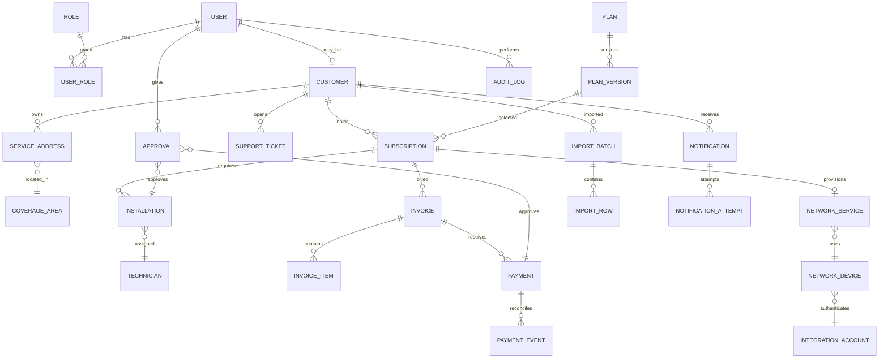

# Rancangan Database dan ERD Awal

## 1. Prinsip model data

- Gunakan UUID/ULID sebagai primary key publik dan timestamp UTC.
- Simpan uang sebagai integer minor unit (misalnya rupiah) dan currency,
  bukan floating point.
- Gunakan enum/status yang eksplisit, foreign key, unique constraint, dan
  soft-delete hanya untuk entitas yang memang membutuhkan histori.
- Data sensitif (credential reference, token reset, payload webhook) dibatasi,
  dienkripsi atau di-redact, dan tidak ditulis ke log biasa.
- Status finansial dan audit bersifat append-only sejauh mungkin. Koreksi
  dilakukan melalui adjustment/reversal, bukan mengubah histori.

## 2. Implementasi schema saat ini

Migration Prisma `20261102214000_customer_service_foundation` membuat model
`BillingRule`, `User`, `Role`, `UserRole`, `Session`, `Registration`,
`RegistrationFollowUp`, dan `AuditLog`, beserta enum `UserStatus`,
`RegistrationStatus`, dan `AuditAction`. Migration
`20261103140000_admin_foundation` menambahkan `User.mustChangePassword`,
`User.passwordChangeExpiresAt`, audit actions untuk lifecycle akun, serta
unique constraint satu role per pengguna. Migration memeriksa duplikasi
assignment sebelum menambah constraint dan berhenti tanpa menghapus assignment
jika duplikasi ditemukan.

Katalog role yang tersedia berisi `general_manager`, `super_admin`, `finance`,
`customer_service`, `noc_network_engineer`, `field_technician`, dan
`auditor_viewer`. Permission ditentukan oleh policy backend, bukan tabel
permission. Pada MVP, permission aktif hanya untuk Super Admin, Customer
Service, General Manager, dan Auditor/Viewer; lihat
[docs/operations-security.md](operations-security.md) untuk matriks aktual.

`Registration` tetap terpisah dari entitas customer. `idempotencyKey` bersifat
unik, session token disimpan sebagai hash, dan snapshot audit meredaksi field
PII. `BillingRule` baru berupa model konfigurasi; workflow subscription,
invoice, dan pembayaran belum tersedia.

Entitas customer, service address, coverage, plan, survey, installation,
subscription, invoice, payment, network, import, approval, dan notification
pada ERD berikut masih merupakan rancangan target, bukan tabel yang sudah
tersedia.

E2E memakai database PostgreSQL lokal terpisah bernama dengan akhiran `_test`.
`TEST_DATABASE_URL` harus eksplisit, hanya boleh menunjuk ke loopback, dan
harus sama dengan `DATABASE_URL` aktif bila variabel tersebut sudah disetel.
E2E hanya memakai fixture sintetis dan membersihkan record fixture dari
database test.

Seed development menggunakan `SEED_ADMIN_EMAIL` dan `SEED_ADMIN_PASSWORD`
yang diberikan pada environment lokal; password di-hash sebelum disimpan.
Seed meng-upsert katalog role, tetapi hanya membuat akun Super Admin jika
email belum ada. Jika akun seed sudah ada, seed tidak mengganti password,
status, atau role akun tersebut.

### Tinjau dan terapkan migration lokal

Migration aktif harus ditinjau sebelum diterapkan:

1. Pastikan `DATABASE_URL` hanya menunjuk ke database development lokal yang
   benar; jangan mencetak URL atau kredensial ke log.
2. Jalankan `npm.cmd exec -- prisma migrate status` dan tinjau file SQL yang
   belum diterapkan di `prisma/migrations/`.
3. Terapkan dengan `npm.cmd exec -- prisma migrate deploy` hanya setelah review.
   Jangan gunakan `migrate reset` pada database yang mungkin berisi data.
4. Verifikasi status migration dan jalankan smoke test lokal.

Migration Prisma tidak menyediakan rollback otomatis. Jika migration gagal
atau perlu dibatalkan, jangan mengedit data produksi manual: siapkan migration
korektif yang ditinjau atau pulihkan backup yang sudah diverifikasi. Migration
apa pun ke database remote memerlukan verifikasi target/status, review SQL,
backup/rollback plan, dan persetujuan eksplisit sebelum dijalankan.

## 3. ERD target (belum seluruhnya diimplementasikan)

## 4. Entitas target

| Entitas target | Kolom penting | Aturan |
| --- | --- | --- |
| `users` | id, email, password_hash, status, last_login_at | email unique; password tidak pernah plaintext |
| `roles`, `permissions`, `user_roles`, `role_permissions` | role dan permission | RBAC granular; jangan hard-code hanya di frontend |
| `customers` | customer_no, legal_name, tax_identity, phone, status | nomor pelanggan unique; identitas pajak nullable sampai dikonfirmasi |
| `service_addresses` | customer_id, address, geo, area_id | satu customer dapat memiliki beberapa alamat |
| `coverage_areas` | code, name, status | area dapat unavailable/planned/available |
| `plans`, `plan_versions` | code, name, speed, price_minor, billing_cycle, effective dates | versioning harga; invoice menyimpan snapshot harga |
| `surveys` | address_id, scheduled_at, result, notes | hasil dan alasan penolakan tercatat |
| `installations` | subscription_id, technician_id, status, completed_at | bukti/checklist terpisah dari status |
| `technicians` | employee_no, user_id, status | assignment melalui work order/installations |
| `subscriptions` | customer_id, plan_version_id, service_no, status, activated_at, first_bill_at | satu service_no unique; instalasi gratis; first bill = satu bulan setelah layanan aktif |
| `network_services` | subscription_id, device_id, pppoe_identifier, status | credential secret di secret manager/reference |
| `network_devices` | vendor, model, host_reference, type, status | tidak menyimpan password router |
| `integration_accounts` | provider, secret_ref, enabled | secret reference, bukan secret value |
| `invoices`, `invoice_items` | invoice_no, issue_at, due_at, service_period, customer_snapshot, company_snapshot, tax_config_snapshot, total_minor, status | format `INV-YYYYMM-XXXXXX`; unik, backend-generated, bukan otomatis faktur pajak |
| `payments` | invoice_id, provider, provider_ref, amount_minor, status | unique provider + provider_ref |
| `payment_events` | provider_event_id, raw_hash, payload_redacted | unique event id; idempotent |
| `support_tickets`, `ticket_messages` | customer, status, priority, message | akses dibatasi customer/staff |
| `notifications` | channel, template, recipient, status | retry dan deduplication key |
| `audit_logs` | actor, action, resource, before/after_redacted | append-only, correlation_id, IP metadata |
| `approvals` | approver_id, type, resource, decision, decided_at, reason | General Manager untuk discount/refund/adjustment; approval staf untuk perubahan customer/subscription |
| `billing_rules` | currency, timezone, grace_days, proration_enabled, deposit_enabled, partial_payment_enabled, penalty_enabled, auto_suspend_enabled, auto_termination_enabled | configurable; default IDR, Asia/Jakarta, grace 5 hari, denda/partial payment/auto-suspend/auto-termination nonaktif |
| `notification_messages`, `notification_attempts` | channel, dedupe_key, status, retry_count, provider_ref | WhatsApp utama, email fallback, portal inbox, retry dan deduplication |
| `import_batches`, `import_rows` | source, status, preview, normalized_data, error_code, approved_by | CSV/Excel; preview, duplicate detection, per-row errors, approval, audit |
| `pon_ports`, `onus` | serial_number, location, status, optical_info_json | vendor-neutral; optical fields nullable sampai perangkat mendukung |
| `invoice_adjustments` | invoice_id, type, amount_minor, reason, approval_id, before_after_snapshot | koreksi append-only, tidak menghapus histori |
| `company_profiles`, `tax_configurations` | legal identity, address, tax identity, effective dates, e-invoice metadata | configurable dan versioned; tidak mengklaim faktur pajak resmi |

## 5. Integritas transaksi target

Pembuatan invoice dan item harus satu transaksi. Nomor invoice dibuat backend
dengan format `INV-YYYYMM-XXXXXX` dan unique constraint. Biaya instalasi gratis,
sehingga tidak ada charge instalasi. Invoice pertama memiliki `bill_at` satu
bulan setelah `activated_at`; prorata didukung melalui rule konfigurasi.
Grace period default adalah 5 hari kalender setelah jatuh tempo. Pembayaran
sebagian dan denda default nonaktif. Suspensi, reconnect, dan termination
memerlukan business rule dan validasi pembayaran eksplisit, tidak berjalan
otomatis.
Webhook pembayaran membuat atau menemukan `payment_event` berdasarkan
event/provider reference, mengunci
invoice, memvalidasi nominal dan status ke provider, lalu mengubah status
invoice secara atomik. Repeated webhook menghasilkan hasil yang sama tanpa
payment ganda.
